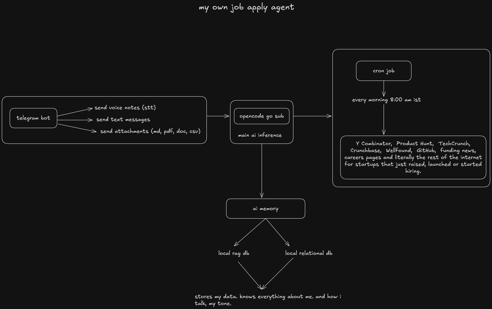

<p align="center">
  
</p>

<h1 align="center">job-agent-bot</h1>

<p align="center">
  A Telegram-controlled, autonomous job-hunting agent that knows me, finds the right startups, and acts on my behalf.
</p>

<p align="center">
  
  
  
  
</p>

---

## The idea

Most "job bots" are scrapers with a chat window bolted on. This one is different.

> **A Telegram-controlled AI agent that continuously discovers new startup job opportunities, understands what fits me using its personal memory, and helps me apply or reach out to those companies.**

The architecture is intentionally built around a loop that isn't just search:

```
know me  →  find relevant companies  →  take job-search actions for me
```

It runs in the background, wakes up every morning, and surfaces the startups that just raised, just launched, or just started hiring — filtered through a memory of who I am.

---

## How it works

<p align="center">
  
</p>

| Layer | What it does |
| --- | --- |
| **Telegram** | The entire interface. Send text, voice notes (STT), or attachments (`.md`, `.pdf`, `.docx`, `.csv`). |
| **OpenCode Go** | The AI brain. Receives requests, runs inference, and drives the agent logic. |
| **AI memory** | My personal context — experience, skills, preferences, tone, writing style — persisted in a local RAG database plus a local relational database. |
| **Scheduled discovery** | A cron job at **8:00 AM IST** every morning sweeps for new opportunities. |

### 1. Telegram is the interface

Everything is driven from a single chat. Ask a question, drop a PDF of your resume, send a voice note on the way to work, or forward a job listing — the bot picks it up and routes it to the brain.

### 2. OpenCode Go is the brain

Requests are forwarded to the OpenCode Go inference endpoint using the `deepseek-v4.1-flash` model, with per-chat conversation state so the agent keeps context across messages.

### 3. AI memory is the differentiator

The agent stores what it learns about me — past roles, projects, strengths, dealbreakers, salary expectations, the way I write — across two local stores:

- **Local RAG database** — semantic recall over my documents, notes, and history.
- **Local relational database** — structured facts: profile, preferences, applications, companies, outreach status.

This is what turns a generic search into *my* search.

### 4. Scheduled discovery, every morning at 8 AM IST

A cron job runs a broad sweep across:

- **Y Combinator** — new batches and companies
- **Product Hunt** — fresh launches
- **TechCrunch**, **Crunchbase**, **Wellfound** — funding rounds and new roles
- **GitHub** — active repos, hiring signals, org activity
- **Funding news** — who just closed a round
- **Career pages** — startups that quietly started hiring
- **The wider web** — anything the above miss

### 5. Targeting: signal over noise

The agent prioritizes startups with a **fresh signal**:

- recently raised funding
- recently launched a product
- recently started hiring

Because it also knows my profile and how I communicate, it can rank opportunities by fit and draft outreach in my own voice — then act on them according to my instructions.

---

## Status

The current build is the foundation of the loop:

- [x] Telegram bot scaffold (grammY) with polling
- [x] OpenCode Go inference integration (`deepseek-v4.1-flash`)
- [x] Per-chat conversation memory with `/start` and `/clear`
- [ ] Voice note transcription (STT)
- [ ] Document, PDF, and CSV ingestion
- [ ] Local RAG + relational memory stores
- [ ] 8:00 AM IST cron-based job discovery
- [ ] Fit scoring, outreach drafting, and application actions

See **[FEATURES.md](FEATURES.md)** for the full phased build plan — starting with live progress reporting so the bot always tells you what it's doing.

---

## Getting started

### Prerequisites

- [Bun](https://bun.com) v1.3+
- A Telegram bot token from [@BotFather](https://t.me/BotFather)
- An OpenCode API key

### Install

```bash
bun install
```

### Configure

Create a `.env` file in the project root (Bun loads it automatically):

```env
TELEGRAM_BOT_TOKEN=your_telegram_bot_token
OPENCODE_API_KEY=your_opencode_api_key
```

### Run

```bash
bun run index.ts
```

Or with hot reload:

```bash
bun --hot index.ts
```

Then message your bot on Telegram. `/start` to begin, `/clear` to reset the conversation.

---

## Project structure

```
job-agent-bot/
├── index.ts          # Telegram bot + OpenCode Go inference loop
├── logo.png          # Project logo
├── architecture.png  # System architecture diagram
├── package.json
└── tsconfig.json
```

---

## Tech stack

- **[Bun](https://bun.com)** — runtime, package manager, env loading
- **[grammY](https://grammy.dev)** — Telegram Bot API framework
- **[OpenCode Go](https://opencode.ai)** — AI inference (`deepseek-v4.1-flash`)
- **TypeScript** — strict, end to end

---

## Philosophy

A job search is not a keyword query. It's a judgment call about fit — company stage, product, team, timing, and whether the work matches the person you actually are.

This agent is built to make that judgment *for me*, continuously, in the background, and to act on it without needing a dashboard, a spreadsheet, or another tab.
